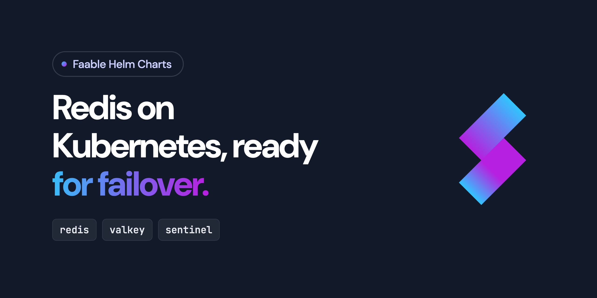

<p align="center">
  <a href="https://faablecloud.github.io/helm-charts">
    
  </a>
</p>

# Faable Helm Charts

The Helm charts that [Faable](https://faable.com) runs in production, published for anyone to use.

## Usage

Add the repository:

```bash
helm repo add faablecloud https://faablecloud.github.io/helm-charts
helm repo update
```

Then run `helm search repo faablecloud` to see the charts.

## Charts

| Chart   | Description                                          |
| ------- | ---------------------------------------------------- |
| `redis` | Redis/Valkey deployment — standalone or Sentinel HA. |

### `redis`

By default the chart runs one Redis pod with a persistent volume. With `sentinel.enabled=true` it
runs a StatefulSet of Redis pods and a Sentinel Deployment that handles failover.

> [!IMPORTANT]
> The default password is `redis`. Always set your own `auth.password`.

**Standalone:**

```bash
helm install cache faablecloud/redis --set auth.password="$REDIS_PASSWORD"
```

Clients connect to the `cache-redis` Service on port 6379.

**High availability with Sentinel:**

```bash
helm install cache faablecloud/redis \
  --set auth.password="$REDIS_PASSWORD" \
  --set sentinel.enabled=true
```

Sentinel-aware clients connect to the `cache-redis-sentinel` Service on port 26379, with the master
name `mymaster`. Redis pods cannot share a node by default, so you need at least as many nodes as
`sentinel.replicaCount` (3), or `podAntiAffinity.redis=soft`.

**Cache only:**

```bash
helm install cache faablecloud/redis \
  --set auth.password="$REDIS_PASSWORD" \
  --set persistence.enabled=false \
  --set maxmemory=256mb
```

#### Main values

| Value                     | Default       | Description                                                           |
| ------------------------- | ------------- | --------------------------------------------------------------------- |
| `image.repository`, `.tag` | `redis`, `7-alpine` | Container image                                                 |
| `auth.password`           | `redis`       | Password for Redis and Sentinel                                       |
| `resources`               | `{}`          | Requests and limits of the Redis pods. Set them in production         |
| `maxmemory`               | `""`          | Dataset ceiling, such as `256mb`. Empty means unlimited               |
| `maxmemoryPolicy`         | `allkeys-lru` | Eviction policy                                                       |
| `persistence.enabled`     | `true`        | Keep data on a volume. Disable it for cache-only datasets             |
| `persistence.size`        | `4Gi`         | Volume size                                                           |
| `sentinel.enabled`        | `false`       | Run with Sentinel failover                                            |
| `sentinel.replicaCount`   | `3`           | Redis pods in Sentinel mode                                           |
| `sentinel.resources`      | `{}`          | Requests and limits of the Sentinel pods                              |
| `affinity`                | `{}`          | Affinity for the Redis and Sentinel pods                              |
| `podAntiAffinity.redis`   | `hard`        | `hard`, `soft` or `""`. Sentinel mode only                            |
| `pdb.enabled`             | `true`        | PodDisruptionBudget. Sentinel mode only                               |

Every value, with its explanation, is in [`values.yaml`](charts/redis/values.yaml).

As a subchart, set the same values under the `redis:` key of the parent chart.

## Releasing

Charts are published automatically by the `release` GitHub Action
([helm/chart-releaser-action](https://github.com/helm/chart-releaser-action)):
on every push to `main`, each chart under `charts/` whose `version` in
`Chart.yaml` was bumped is packaged, attached to a GitHub Release, and indexed
in `index.yaml` on the `gh-pages` branch (served via GitHub Pages).

To cut a new version: bump `version:` in the chart's `Chart.yaml`, commit, and
merge to `main`. Consumers then run `helm dependency update`.

## Support

- **Documentation:** [faable.com/docs](https://faable.com/docs)
- **Help with your account or deployments:** [support@faable.com](mailto:support@faable.com) or the
  [support page](https://faable.com/docs/platform/support)
- **Chart bugs and requests:** [open an issue](https://github.com/faablecloud/helm-charts/issues)
- **Security issues:** report them privately to [support@faable.com](mailto:support@faable.com),
  not in a public issue

## License

[MIT](LICENSE) © Faable Cloud SLU
